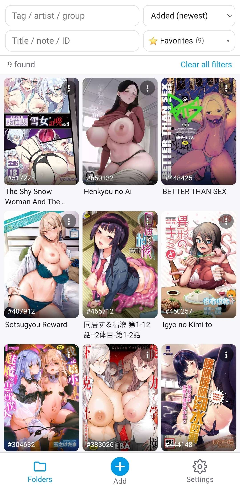
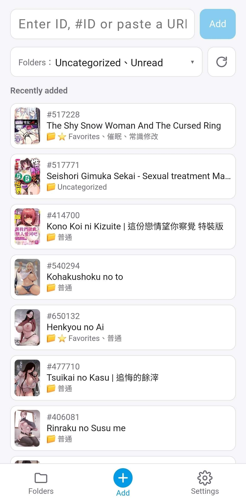
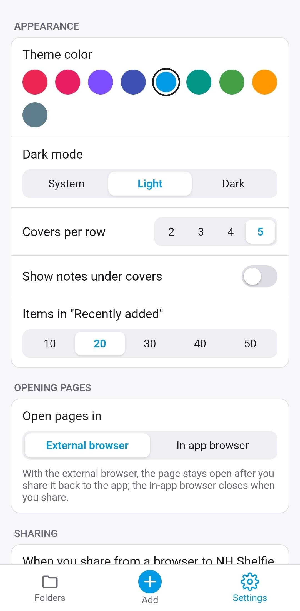

[繁體中文](README.md) | **English**

  

<h1 align="center">NH Shelfie</h1>

Your own nhentai bookshelf on your phone: save galleries by ID, sort them into folders — no account, nothing uploaded.

  
  
  

<h3 align="center">
  <a href="https://github.com/anson669989/NH-Shelfie/releases/latest">⬇️ Download the latest APK</a>
</h3>

## ✨ Features

### ⚡ Quick saving
- **Any ID format works**: plain numbers, `#228922`, or a full URL
- **Add from your browser**: tap "Share" on a gallery page and pick NH Shelfie. The ID is filled in for you
- **Save instantly**: switch sharing to "Save instantly" and you never leave the browser — you just see "Saved"

### 📁 Organize & search
- **Folders**: put one book in several folders
- **Unread & Favorites**: new books land in Unread automatically — remove them when you're done; keep the ones you love in ⭐ Favorites
- **Manage folders & dividers**: drag to reorder, rename, and group folders with dividers
- **Search**: find books by title, note, or ID
- **Tag filters**: filter by nhentai tag, artist, or group
- **Tag translation**: the tag filter can show Chinese or Japanese names (following the app language); search by either the original or the translation
- **Multi-select**: long-press a cover to sort, remove, or delete several books at once
- **Notes**: add a note to any book and optionally show it under the cover

### 🔒 Privacy
- **Stored on your phone, no account needed**: all data stays on your phone
- **Mom mode**: replaces covers with plain light gray, and can also hide titles and notes

### 🛠️ More
- **Four languages**: 繁體中文, 简体中文, English, 日本語
- **Choose how links open**: external browser or in-app browser
- **Export backup**: export to CSV and import it on a new phone in one step (folder order, dividers, Unread / Favorites and sharing settings come along too)

## 📱 Screenshots

  
  
  

Library · Add · Settings

## 🚀 Quick start

1. **Download and install**: open "Download the latest APK" above on your phone, download `nh-shelfie.apk` and tap it to install.
2. **Add your first item**: in the Add tab, enter an ID (e.g. `228922` or `#228922`) and tap Add. Or tap Share on a browser page and choose NH Shelfie; set Settings → Sharing to "Save instantly" to save without leaving the browser.
3. **Sort it**: pick folders before adding (your last choice is remembered). Later, tap "⋮" on a cover → Folders, or long-press covers to select several and sort them at once.
4. **Find things**: on the Library tab, type a tag / artist / group in the first row and tick it; type a title, note or ID in the second row; the folder filter lets you tick several folders. "Clear all" at the top-right of each drop-down unticks everything in one tap.

## ❓ FAQ

<b>Android says "unknown sources" or blocks the install. What do I do?</b>

The app isn't on Google Play, so Android asks for permission. Tap "Settings" in the prompt, allow "Install unknown apps" for the browser (or file manager) you downloaded with, then go back and tap Install. If Play Protect shows a warning, choose "Install anyway".

<b>How do I update?</b>

Download the new APK from the [Releases page](https://github.com/anson669989/NH-Shelfie/releases/latest) and install it over the old one — your collection is kept. **Don't uninstall first**: uninstalling deletes your data.

<b>Where is my data stored?</b>

Your list, folders and covers are stored in the app's private storage on this phone. Other apps can't see them and covers don't show up in your gallery.

<b>How do I move to a new phone?</b>

Old phone: Settings → Data → Export CSV, then save it to cloud storage or send it to yourself. New phone: install the app, then Settings → Data → Import CSV. Folders (including their order and dividers), Unread / Favorites and sharing settings are restored, and titles and covers are downloaded again automatically.

## 🔐 Privacy

All data lives only on your phone. The app collects and uploads nothing, has no ads or analytics, and needs no login.

The app connects to only two places, and never sends your collection to either:

1. **nhentai**: to fetch public titles, tags and covers.
2. **GitHub**: only when "Tag translation" is on, to download a public translation data file at most once a day (Chinese data for a Chinese app language, Japanese data for Japanese; nothing for English).

## 🙏 Credits & licenses

- **Chinese tag translations** come from [EhTagTranslation/Database](https://github.com/EhTagTranslation/Database), licensed under CC BY-NC-SA 3.0. The data is downloaded on your phone and converted to Traditional Chinese there, using [opencc-js](https://github.com/nk2028/opencc-js).
- **Japanese tag translations** come from [EhPanda Tag Database](https://github.com/EhPanda-Team/ehpanda-tag-database): the tag list is derived from EhTagTranslation/Database (CC BY-NC-SA 3.0), the Japanese names come from [e-hentaidb.com](https://e-hentaidb.com/tag/) (CC BY 4.0), and some names are from the "E(x)Hentai Japanese localization userscript" by Nu.
- Both datasets are downloaded only on your phone; neither the app nor this repo includes them. Under the NC (non-commercial) terms, this app is not used commercially.

## ⚖️ Disclaimer

This is an unofficial personal project and is not affiliated with nhentai in any way. Please follow the laws where you live.

---

Developer docs (architecture, build, release): [docs/DEVELOPMENT.md](docs/DEVELOPMENT.md)
