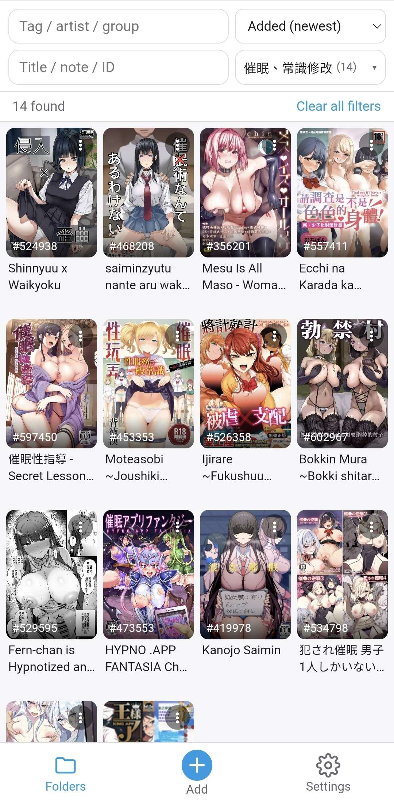
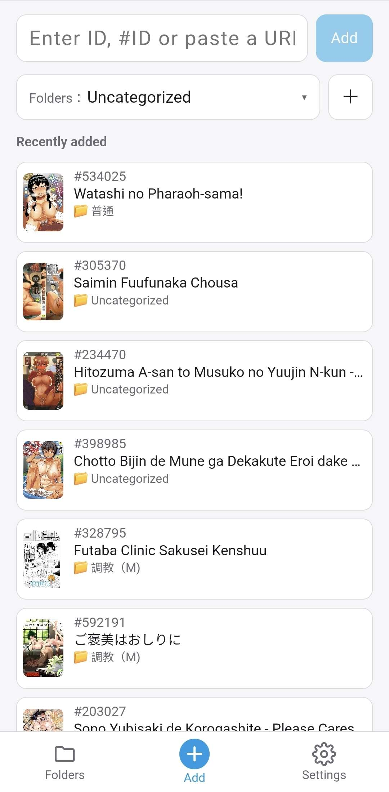
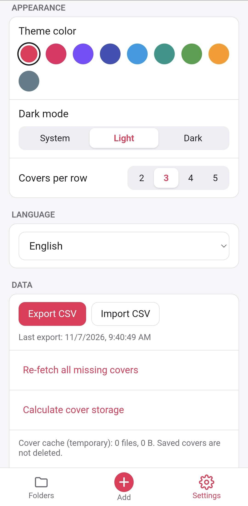

[繁體中文](README.md) | **English**

  

<h1 align="center">NH Shelfie</h1>

Your own nhentai bookshelf on your phone: save galleries by ID, sort them into folders — no account, nothing uploaded.

  
  
  

<h3 align="center">
  <a href="https://github.com/anson669989/NH-Shelfie/releases/latest">⬇️ Download the latest APK</a>
</h3>

## ✨ Features

- 🔒 **Local collection, no account**: everything stays on your phone.
- ⚡ **Add without waiting**: type an ID and tap Add — title and cover are filled in automatically in the background.
- 🔢 **Paste the ID any way**: plain numbers, `#228922` or a URL all work.
- 🔗 **Add from the browser's Share menu**: tap Share on a page → NH Shelfie, and the ID is filled in.
- 📁 **Folders**: put an item in several folders; each folder remembers its own sort order; hold ≡ and drag to reorder folders.
- 🔍 **Search and tag filters**: search by title, note or ID; tick tags, artists and groups to filter; pick several folders at once.
- 📝 **Notes**: write a one-line note in the "⋮" menu and optionally show it under the cover.
- 🙈 **Privacy mode**: turn covers into plain grey boxes (and optionally hide titles and notes) so nobody gets an awkward glance at your screen.
- 🌐 **Choose how pages open**: tap a cover to open it in your system browser or the in-app browser.
- ☑️ **Multi-select**: long-press a cover to select many, then add to folders, remove or delete at once.
- ⋮ **Item menu**: the button at the top-right of each cover shows full titles, lets you write a note, copies the ID and re-fetches the cover; long-press an item in "Recently added" to open it too.
- 🌏 **Four languages**: 繁體中文, 简体中文, English, 日本語.
- 💾 **Export for backup**: export a CSV and import it on a new phone.

## 📱 Screenshots

  
  
  

Library · Add · Settings

## 🚀 Quick start

1. **Download and install**: open "Download the latest APK" above on your phone, download `nh-shelfie.apk` and tap it to install.
2. **Add your first item**: in the Add tab, enter an ID (e.g. `228922` or `#228922`) and tap Add. Or tap Share on a browser page and choose NH Shelfie.
3. **Sort it**: pick folders before adding (your last choice is remembered). Later, tap "⋮" on a cover → Folders, or long-press covers to select several and sort them at once.
4. **Find things**: on the Library tab, type a tag / artist / group in the first row and tick it; type a title, note or ID in the second row; the folder filter lets you tick several folders. "Clear all" at the top-right of each drop-down unticks everything in one tap.

## ❓ FAQ

<b>Android says "unknown sources" or blocks the install. What do I do?</b>

The app isn't on Google Play, so Android asks for permission. Tap "Settings" in the prompt, allow "Install unknown apps" for the browser (or file manager) you downloaded with, then go back and tap Install. If Play Protect shows a warning, choose "Install anyway".

<b>How do I update?</b>

Download the new APK from the [Releases page](https://github.com/anson669989/NH-Shelfie/releases/latest) and install it over the old one — your collection is kept. **Don't uninstall first**: uninstalling deletes your data.

<b>Where is my data stored?</b>

Your list, folders and covers are stored in the app's private storage on this phone. Other apps can't see them and covers don't show up in your gallery.

<b>How do I move to a new phone?</b>

Old phone: Settings → Data → Export CSV, then save it to cloud storage or send it to yourself. New phone: install the app, then Settings → Data → Import CSV. Folders are recreated, and titles and covers are downloaded again automatically.

## 🔐 Privacy

All data lives only on your phone. The app collects and uploads nothing, has no ads or analytics, and needs no login. It only connects directly to the website to fetch public titles and covers.

## ⚖️ Disclaimer

This is an unofficial personal project and is not affiliated with nhentai in any way. Please follow the laws where you live.

---

Developer docs (architecture, build, release): [docs/DEVELOPMENT.md](docs/DEVELOPMENT.md)
