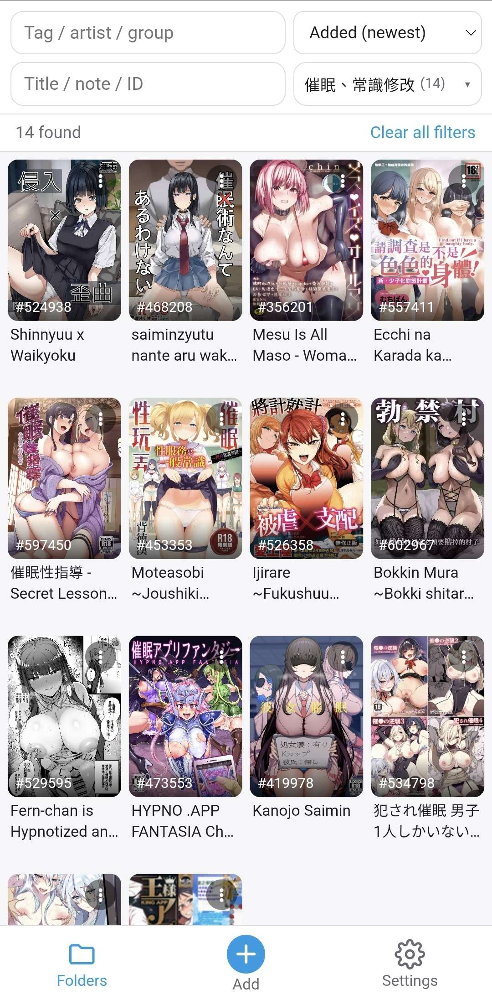
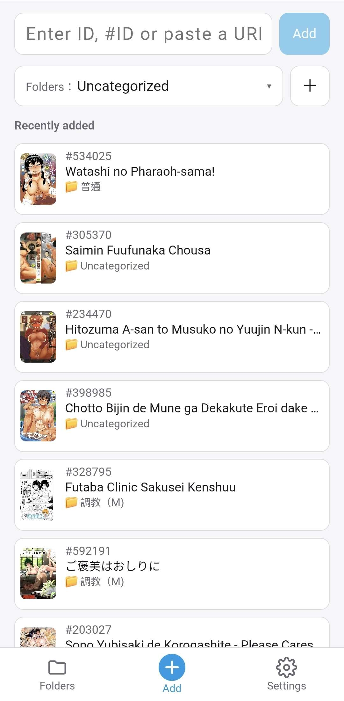
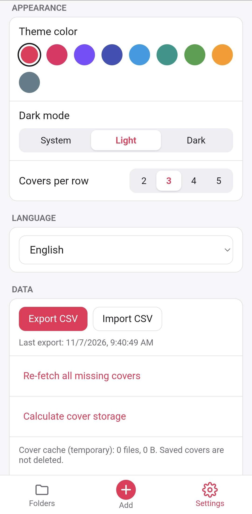

**繁體中文** | [English](README.en.md)

  

<h1 align="center">NH Shelfie</h1>

自訂義收藏nhentai本子：輸入 ID 就收藏，用資料夾分類，不用帳號、不上傳任何資料。

  
  
  

<h3 align="center">
  <a href="https://github.com/anson669989/NH-Shelfie/releases/latest">⬇️ 下載最新版 APK</a>
</h3>

## ✨ 特色

- 🔒 **本機收藏，不需帳號**：所有資料只存在手機裡。
- ⚡ **加入不用等**：輸入 ID 按「加入」就完成，書名和封面在背景自動補上。
- 🔢 **ID 怎麼貼都行**：純數字、`#228922`、網址都認得。
- 🔗 **從瀏覽器分享就能加入**：在網頁按「分享」→ 選 NH Shelfie，ID 自動填好。
- 📁 **資料夾分類**：一本可以放多個資料夾，各資料夾自己記住排序；按住 ≡ 拖曳就能調整資料夾順序。
- 🔍 **搜尋與標籤篩選**：用書名、備註或 ID 搜尋；勾選標籤、作者、社團一起篩選；資料夾也能一次勾好幾個。
- 📝 **備註**：在「⋮」選單寫一行備註，也可以設定顯示在封面下方。
- 🙈 **媽媽模式**：一鍵把封面換成灰色方塊（也可隱藏書名、備註），旁人看到螢幕也不尷尬。
- 🌐 **開啟方式可選**：點封面用系統瀏覽器或 App 內瀏覽器開網頁。
- ☑️ **多選整理**：長按封面進入多選，一次分類、移除或刪除。
- ⋮ **單本選單**：封面右上角看完整標題、寫備註、複製 ID、重抓封面；「最近加入」長按也能開。
- 🌏 **四種語言**：繁體中文、简体中文、English、日本語。
- 💾 **資料可匯出備份**：匯出 CSV，換手機一鍵匯入。

## 📱 頁面

  
  
  

收藏頁　·　加入頁　·　設定頁

## 🚀 快速上手

1. **下載安裝**：用手機打開上面的「下載最新版 APK」，下載 `nh-shelfie.apk` 後點開安裝。
2. **加入第一本書**：到「新增」分頁輸入 ID（例如 `228922` 或 `#228922`），按「加入」。也可以在瀏覽器頁面按「分享」選 NH Shelfie。
3. **分類**：加入前先選好資料夾（會記住上次的選擇）；之後在收藏頁點封面右上角「⋮」→「分類」，或長按封面多選後一次分類。
4. **找書**：收藏頁上方第一列打標籤／作者／社團名稱並勾選，第二列打書名、備註或 ID；右下的資料夾篩選可以一次勾好幾個資料夾。下拉清單右上角的「全部清除」可以一鍵取消勾選。

## ❓ 常見問題

<b>安裝時出現「未知來源」或「禁止安裝」怎麼辦？</b>

這個 App 不在 Google Play 上架，所以 Android 會詢問是否允許。請在跳出的畫面按「設定」，對你用來下載的瀏覽器（或檔案管理員）開啟「允許安裝不明應用程式」，再回去按安裝。若 Play Protect 顯示警告，選「仍要安裝」即可。

<b>怎麼更新？</b>

到 [Releases 頁](https://github.com/anson669989/NH-Shelfie/releases/latest) 下載新版 APK，直接安裝覆蓋即可，收藏會保留。**不要先解除安裝**，解除安裝會把資料一起刪掉。

<b>資料存在哪裡？</b>

收藏清單、資料夾和封面都存在這支手機的 App 私人空間，其他 App 看不到，也不會出現在相簿裡。

<b>換手機怎麼搬資料？</b>

舊手機：設定 → 資料 → 匯出 CSV，透過分享存到雲端硬碟或傳給自己。新手機：安裝 App 後到設定 → 資料 → 匯入 CSV，資料夾會照原樣建立，書名和封面會自動重新下載。

## 🔐 隱私

所有資料只存在你的手機上。App 不收集、不上傳任何資料，沒有廣告、沒有分析追蹤，也不需要登入。只有在補書名和封面時，才會直接連到網站取得公開資料。

## ⚖️ 免責聲明

本 App 為非官方的個人專案，與 nhentai 沒有任何關係。請遵守你所在地區的法律。

---

開發者文件（架構、建置、發佈）：[docs/DEVELOPMENT.md](docs/DEVELOPMENT.md)
